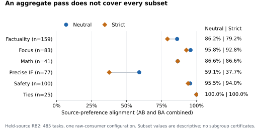

# Dark Current

**Passing an exact-clone check does not establish useful target selection.**

This repository accompanies *LLM Judges Have Dark Current: Stratified Null and Utility Tests for LLM Judge Reliability*. Here, dark current means a non-tie preference between byte-identical answers. A configuration comprises the declared model profile, prompt, decoder, parser, and backend. Neutral and strict are the two declared grading criteria. The audit separates output validity, preferences between identical answers, and selection of a declared target. Each is a different question; evidence for one does not answer the others.

[Manuscript (PDF)](paper/main.pdf) · [Read the findings](START_HERE.md) · [Reproduce an audit](REPRODUCTION_MAP.md) · [Data and scope](DATASHEET.md)

## Findings

| Question | Observation | Evaluation consequence |
|---|---|---|
| Does a clean clone result imply useful selection? | On 102 prespecified fresh rows, all four configuration–criterion cells have 0/102 clone preferences; neutral utility passes, while the strict one-sided lower bounds (.539 and .745) do not reach the .75 working threshold. | Report matched clone and utility results separately. |
| Does aggregate passage cover the intended task subset? | One separate configuration on a fixed mixture of 485 RewardBench 2 rows passes both aggregate working gates under both criteria; strict Precise Instruction Following alignment is 58/154. | Examine the application subset as well as the aggregate. |
| Can output handling be ignored? | A separate campaign has 612 completed outputs: 401 valid and 211 invalid. | Apply the declared validity gate before interpreting a configuration. HOLD means that the declared validity gate prevents interpreting its clone and utility cells. |

<p align="center">
  
</p>

*Source-label alignment in the separate mixture of 485 rows across six benchmark subsets, for one installed raw-text configuration. The subset rate 58/154 is descriptive; it is not a subset certificate or the fresh 102-row result.*

A separate neutral configuration also passes the utility gate but has two clone preferences in 102 rows; its upper bound does not certify the declared low-null rate. Non-certification alone does not establish a defective judge.

## Use the audit

1. Fix the configuration, consumer, target, working thresholds, and application loss before looking at the results.
2. Check output validity, exact-clone behavior, and target-selection utility as separate stages.
3. Report the aggregate and intended task subsets. Preserve invalid outputs and incomplete studies instead of repairing them after the outcome.

These distinctions identify gaps in an evaluation. A reduction in deployment loss has not been measured.

## Check the saved artifact

From this directory, with Python 3.11+:

```sh
python3 verify_release.py
python3 held_source485/verify_recorded.py
```

Expected results are `PASS_RELEASE_FILE_HASHES` and `PASS_SAVED_METADATA_CHECKS_ONLY`. These checks inspect file hashes, saved counts, and bindings with zero model calls. They do not regenerate outputs or recompute confidence bounds. [Study-specific reproduction routes](REPRODUCTION_MAP.md) state what each route checks.

## Evidence and scope

The manuscript has 21 pages, four figures, and nine tables. The [evidence map](PAPER_EVIDENCE_MAP.json) connects all 13 objects to their source and saved evidence. See the [configuration map](STUDY_CONFIGURATION_MAP.json), [environment](EXPERIMENT_ENVIRONMENT.md), and [artifact card](ARTIFACT_CARD.md) for the experimental contracts.

Clone binomial summaries use their stated Bernoulli working model; utility intervals describe task resampling within the declared empirical strata. Clone Holm families are study-specific; the 485-row extension adjusts its two clone p-values. Criterion-specific utility bounds do not provide a joint population guarantee. Source labels and finite-domain truth are distinct targets. The 51 human-equivalence items have no human labels; general semantic correctness and a population ranking are not established. Historical build gaps for Figures 1 and 2 remain documented.

## Reuse and release

**Private author-review repository; public release and journal submission are pending.** External redistribution scope and outgoing licensing remain subject to final confirmation. See [upstream notices](UPSTREAM_LICENSES.md), the [file rights ledger](FILE_RIGHTS_LEDGER.json), and [template notices](paper/TEMPLATE_NOTICES.md). Raw benchmark text, candidate bodies, raw responses, weights, and private operating information are excluded.

We thank Orazio Oztas for sharing [dark-current-mlx](https://github.com/oraziooztas/dark-current-mlx), an independent Apple Silicon/MLX pilot inspired by Dark Current v1.
